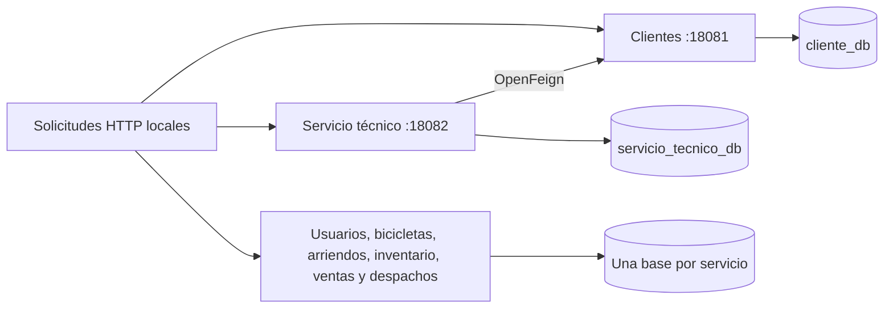

# Arquitectura y contratos de demostración

Ocho aplicaciones Spring Boot independientes, cada una con su base MySQL y migraciones Flyway. Los puertos HTTP se publican solo en 127.0.0.1. MySQL permanece en la red interna de Compose. La única consulta HTTP entre servicios implementada aquí es servicio técnico → clientes mediante OpenFeign.



| Servicio | Ruta base | Métodos del recorrido |
|---|---|---|
| Clientes | /api/v1/clientes | GET lista, GET /{id}, POST |
| Servicio técnico | /api/v1/ordenes-servicio | GET lista, GET /{id}, POST |
| Usuarios | /api/v1/usuarios | GET lista, GET /{id}, POST |
| Bicicletas | /api/v1/bicicletas | GET lista, GET /{id}, POST |
| Arriendos | /api/v1/arriendos | GET lista, GET /{id}, POST |
| Inventario | /api/v1/inventario | GET lista, GET /{id}, POST |
| Ventas | /api/v1/ventas | GET lista, GET /{id}, POST |
| Despachos | /api/v1/despachos | GET lista, GET /{id}, POST |

Las operaciones de modificación adicionales varían por controlador; consultar /api-docs en cada puerto para el contrato completo. El recorrido no afirma probar exhaustivamente todos los endpoints.

## Ejemplo de consulta entre servicios

```sh
curl http://127.0.0.1:18082/api/v1/ordenes-servicio/1
```

La respuesta incluye una propiedad cliente obtenida desde clientes. La creación de una orden con idCliente inexistente responde 404. El servicio técnico depende de la disponibilidad del servicio clientes; no hay caché ni tolerancia distribuida completa.

## Alcance académico

- Sin gateway, autenticación completa, autorización por rol ni despliegue de producción. Un campo rol es solo un dato.
- No hay transacción distribuida. Las referencias de cliente/bicicleta/venta de los demás servicios no garantizan existencia en las bases ajenas.
- Las validaciones cubren campos obligatorios y determinados límites; no constituyen una validación integral de reglas de negocio, identidad o tributación.
- Los endpoints aceptan entidades/DTO del ejercicio; no se afirma protección completa frente a todos los usos indebidos.
- MasterBike Data Pipeline es un proyecto complementario independiente. Su ingesta lee seis archivos JSON sintéticos; no consume automáticamente estas ocho API ni comparte sus bases.
- Datos de demostración: clientes con códigos DEMO, correos example.invalid y operaciones ficticias. No usar datos reales en esta muestra sin una revisión adicional.

El trabajo de preparación sobre la copia corrige configuración, migraciones, pruebas y demostración; se conserva el carácter académico del sistema y se reconoce la asistencia de Codex.
